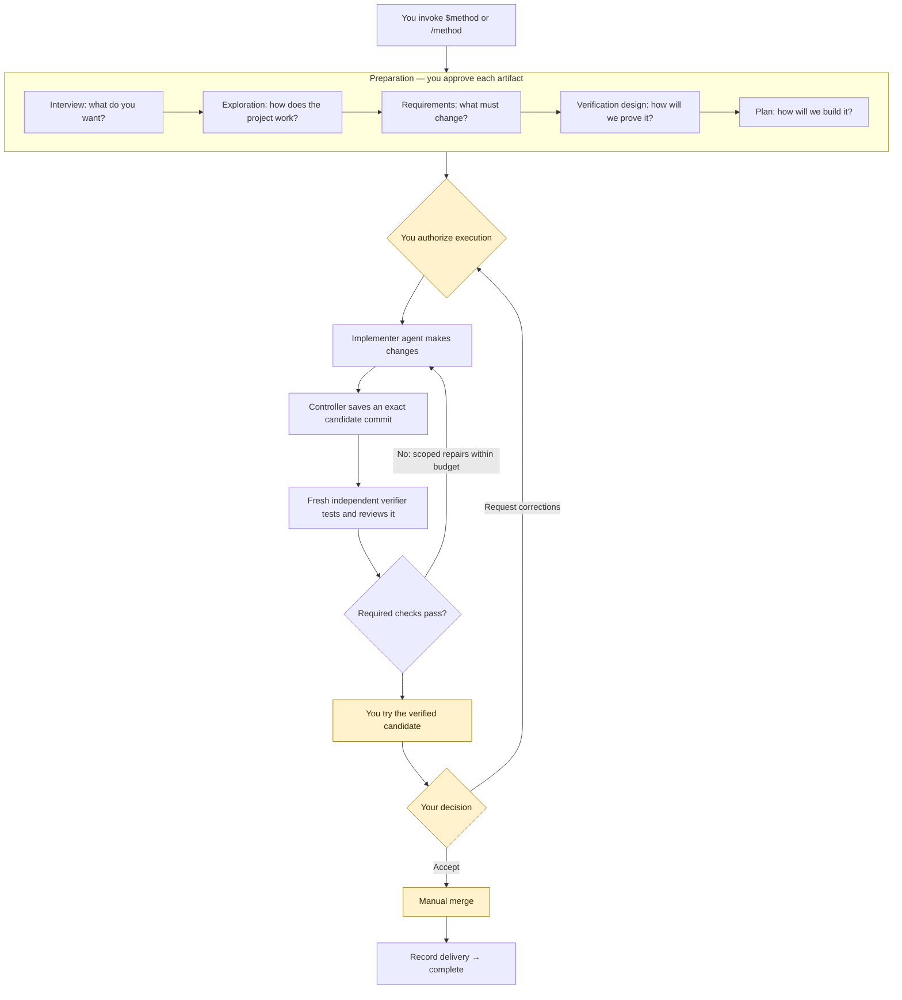

# Method workflow

Method moves a task from an idea to a recorded merge. You approve the preparation
documents, then authorize implementation. An implementer changes the code, and a
fresh independent verifier checks an exact candidate commit. You try and accept
the verified candidate before manual delivery.

Repairs use the remaining execution budget. Code changes require a new candidate
and fresh verification. Requirement changes return to preparation for approval.
The dashboard shows progress and evidence; decisions stay in the conversation.

For maintenance details, see [Method controller internals](method-controller.md).
